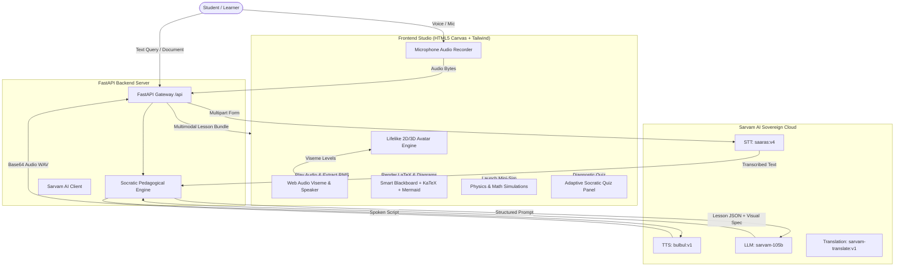

# 🎓 Sarvam AI Avatar Tutor

> **Multilingual, Lifelike AI Avatar Tutor powered by Sarvam AI's Indic Sovereign AI Platform**
> 
> *Teach through lifelike AI avatars with expressive voice, gestures, and multilingual conversations.*  
> *Explain concepts visually using whiteboards, diagrams, documents, and interactive demonstrations.*  
> *Personalize every session with adaptive questioning, instant feedback, and progress tracking.*

---

## 🌟 Key Features

1. **Lifelike Animated AI Avatars**
   - **4 Indian Educator Personas**: Prof. Priya Sharma (Physics/STEM), Dr. Aryan Patel (Computer Science/AI), Tutor Anushka Rao (Calculus/Geometry), and Mentor Shubh Verma (History/Culture).
   - **Real-Time Viseme Lip-Sync**: Powered by Web Audio API frequency analysis coupled directly to Sarvam Bulbul voice output.
   - **Expressive Physical Gestures**: Whiteboard pointing (with synchronized laser ray), nodding in encouragement, pensive thinking, and celebratory victory animations.
   - **Natural Micro-Animations**: Blinking, breathing oscillation, and reactive eye-gaze tracking.

2. **Sarvam AI Indic Multimodal Voice & Reasoning Engine**
   - **Speech-to-Text (`saaras:v4`)**: Speaks and transcribes speech in Hindi, English, Bengali, Tamil, Telugu, Marathi, Gujarati, Kannada, Malayalam, Punjabi, Odia, and Hinglish.
   - **Text-to-Speech (`bulbul:v1`)**: Ultra-natural Indic voice synthesis with multiple native speaker personas (`meera`, `amartya`, `anushka`, `shubh`).
   - **Socratic Pedagogical Brain (`sarvam-105b`)**: Structured tutor reasoning that breaks concepts into intuitive analogies, whiteboard notes, and LaTeX formulas.
   - **Multilingual Translation (`sarvam-translate:v1`)**: Real-time cross-language explanations for Indian vernacular learners.

3. **Smart Interactive Whiteboard & Visual Demos**
   - **Chalkboard Notes**: Real-time bullet-point breakdowns.
   - **KaTeX Formula Rendering**: Beautiful rendering of complex mathematical and physics equations.
   - **Mermaid.js Dynamic Diagrams**: Flowcharts, mind maps, and algorithm state machines generated on the fly.
   - **4 Interactive Simulations**:
     - 🚀 *Projectile Motion Simulator*: Trajectory tracing, live apex height, and range calculations.
     - 📐 *Pythagoras & Trigonometry Visualizer*: Interactive geometric triangle proof with live sine/cosine/tangent waves.
     - 🔍 *Binary Search Visualizer*: Step-by-step divide-and-conquer search space elimination.
     - 🪐 *Planetary Gravity & Orbits*: Orbital mechanics and Newton's inverse-square gravitational pull demonstration.
   - **Document & Homework Ingestion**: Upload notes or textbook pages for instant tutor breakdown.

4. **Adaptive Questioning & Progress Tracking**
   - **Socratic Diagnostic Checks**: Automatically calibrates question difficulty across *Foundation*, *Application*, and *Mastery* tiers.
   - **Progressive Hints**: Tier 1 (Gentle Nudge) $\to$ Tier 2 (Conceptual Clue) $\to$ Tier 3 (Step-by-step Solution).
   - **Mastery Analytics**: Live topic mastery gauge, streak counter, and downloadable session study notes (`.md`).

---

## 🏗️ System Architecture



---

## 🚀 Quickstart: Running Locally

### 1. Prerequisites
- **Python 3.10+** (Tested on Python 3.11, 3.12, 3.14)
- **Sarvam AI API Key** (Get free credits at [dashboard.sarvam.ai](https://dashboard.sarvam.ai))  
  *(Note: The app also includes a fully functional offline Demo Mode with simulated speech and avatars even without an API key)*

### 2. Install Dependencies
```bash
cd c:\Users\91639\Desktop\Sarvam.ai
pip install -r backend/requirements.txt
```

### 3. Configure API Key
Copy the example environment file and add your key:
```bash
cp .env.example .env
```
Edit `.env`:
```ini
SARVAM_API_KEY=your_sarvam_api_key_here
```
*(You can also set or change your key directly inside the web UI Settings modal).*

### 4. Run the Server
```bash
python run_server.py
```
Open your browser and navigate to:
```
http://localhost:8000
```

---

## 🚢 Production Deployment Guide

### Option 1: Docker / Docker Compose (Recommended for Any Cloud)
The project includes an optimized multi-stage `Dockerfile` and `docker-compose.yml`.

1. **Build and launch with Docker Compose**:
   ```bash
   docker compose up -d --build
   ```
2. Check running status:
   ```bash
   docker compose ps
   docker compose logs -f
   ```
3. Access at `http://YOUR_SERVER_IP:8000`.

---

### Option 2: Render.com (One-Click Web Service)
1. Push this repository to **GitHub**.
2. Go to [Render Dashboard](https://dashboard.render.com) $\to$ **New Web Service**.
3. Connect your GitHub repository.
4. Settings:
   - **Environment**: `Python` (or `Docker`)
   - **Build Command**: `pip install -r backend/requirements.txt`
   - **Start Command**: `uvicorn backend.app:app --host 0.0.0.0 --port $PORT`
5. Under **Environment Variables**, add:
   - `SARVAM_API_KEY`: `your_sarvam_api_key`
6. Click **Deploy Web Service**.

---

### Option 3: Hugging Face Spaces
1. Create a new Space on [Hugging Face](https://huggingface.co/new-space).
2. Choose **Docker** as the Space SDK.
3. Push your repository to the Hugging Face Space git remote.
4. Go to **Settings $\to$ Repository Secrets**:
   - Add Secret `SARVAM_API_KEY` = `your_sarvam_api_key`.
5. Your AI Avatar Tutor will be live on `https://huggingface.co/spaces/<your-username>/<your-space-name>` with HTTPS and global CDN.

---

### Option 4: Railway.app
1. Go to [Railway](https://railway.app) $\to$ **New Project $\to$ Deploy from GitHub repo**.
2. Railway will automatically detect the `Dockerfile` or `requirements.txt`.
3. Add Variable `SARVAM_API_KEY` in the Railway Variables tab.
4. Railway provides an automatic public domain with SSL.

---

### Option 5: AWS EC2 / DigitalOcean / GCP Compute Engine
1. Launch an Ubuntu 22.04 LTS instance.
2. Clone repository and install Docker:
   ```bash
   git clone <your-repo-url>
   cd Sarvam.ai
   sudo apt update && sudo apt install -y docker.io docker-compose
   ```
3. Set your API key in `.env`:
   ```bash
   echo "SARVAM_API_KEY=your_key_here" > .env
   ```
4. Start container:
   ```bash
   sudo docker-compose up -d --build
   ```
5. Configure Nginx reverse proxy with Certbot for custom domain and free SSL certificate.

---

## 📂 Project Structure

```
Sarvam.ai/
├── backend/
│   ├── app.py                # FastAPI server (STT, TTS, Chat, Translation, Document endpoints)
│   ├── config.py             # App configuration & environment loader
│   ├── sarvam_client.py      # Production Sarvam AI client (Saaras, Bulbul, Sarvam-105B)
│   ├── tutor_engine.py       # Socratic pedagogy, synchronized gestures, and whiteboard specs
│   └── requirements.txt      # Python dependencies
├── frontend/
│   ├── index.html            # 3-column interactive studio SPA
│   ├── css/
│   │   └── styles.css        # Glassmorphic UI, chalkboard aesthetics, and animations
│   └── js/
│       ├── app.js            # Main application controller
│       ├── avatar.js         # Lifelike Canvas 2D/3D Avatar with viseme mouth & gestures
│       ├── whiteboard.js     # Smart blackboard, KaTeX math & Mermaid renderer
│       ├── simulations.js    # 4 Interactive simulations (Projectile, Pythagoras, Binary Search, Orbits)
│       └── audio.js          # Web Audio recorder and Viseme lip-sync analyser
├── Dockerfile                # Production multi-stage Dockerfile
├── docker-compose.yml        # Docker Compose configuration
├── .env.example              # Sample environment configuration template
├── .env                      # Local environment file
├── .gitignore                # Git ignore configuration
├── run_server.py             # One-click startup script
└── README.md                 # Project documentation & deployment manual
```

---

## 🔒 Security & Best Practices
- Never commit your `SARVAM_API_KEY` to public GitHub repositories.
- Use environment variables or cloud secrets management (e.g. AWS Secrets Manager, Render Env Vars, Docker secrets).
- In production, configure rate limiting and HTTPS reverse proxy (Nginx or Cloudflare) to protect STT/TTS bandwidth.
